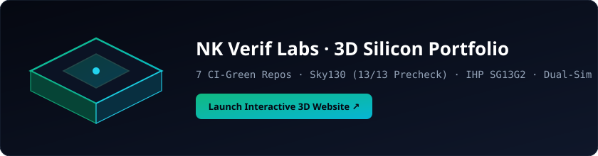

  <h1>Hi there, I'm Niranjankumar Katragadda 👋</h1>
  <h3>Physical Design Engineer | Founder & Principal Verification Engineer at <a href="https://niranjankumarkatragadda.github.io">NK Verif Labs</a></h3>

  

    
    
    
  

---

### 🚀 About Me

I specialize in **Digital IP Functional Verification (SystemVerilog / Cocotb)** and **RTL-to-GDSII Physical Design flows**. Through **NK Verif Labs**, I build open-source verification IP (VIP) suites, protocol monitors, and automated CI regression workflows, while partnering with semiconductor teams on independent IP verification projects.

* 🔭 **Current Focus:** Reusable Cocotb verification environments, AMBA protocol monitors, and RTL-to-GDSII ASIC flows on SkyWater 130nm & IHP SG13G2 PDKs.
* 🛠️ **Core Domains:** Functional Verification, Clock-Domain Crossing (CDC), Synthesis, Floorplanning, CTS, Routing & STA.
* 📫 **Direct Contact:** `nkveriflabs@gmail.com`

---

### 🛠️ Tech Stack & EDA Toolchain

  
  
  
  
  
  
  
  

* **Verification & Simulation:** SystemVerilog, Cocotb, Python, Icarus Verilog, GTKWave, GitHub Actions CI
* **Physical Design & STA:** Cadence Innovus, Cadence Genus, Cadence Tempus, OpenLane, OpenROAD, LibreLane, SkyWater 130nm & IHP SG13G2 (130nm BiCMOS) PDKs
* **Scripting & OS:** Tcl, Bash, Perl, Python, Ubuntu (WSL2)

---

### 🚀 Featured Open-Source Projects</h3>
<table><thead><tr><th>Project</th><th>Target / Stack</th><th>Proof</th></tr></thead><tbody>
<tr><td><a href="https://github.com/NiranjankumarKatragadda/riscv-rv32i-physical-design">riscv-rv32i-physical-design</a></td><td>Sky130 · OpenLane</td><td>13/13 cf-precheck PASS</td></tr>
<tr><td><a href="https://github.com/NiranjankumarKatragadda/ihp-sg13g2-systolic-array">ihp-sg13g2-systolic-array</a></td><td>IHP SG13G2 · LibreLane + Cocotb</td><td></td></tr>
<tr><td><a href="https://github.com/NiranjankumarKatragadda/ihp-sg13g2-axi4-dma">ihp-sg13g2-axi4-dma</a></td><td>IHP SG13G2 · 16-Beat INCR + cocotbext-axi</td><td></td></tr>
<tr><td><a href="https://github.com/NiranjankumarKatragadda/noc-mesh-4x4-cocotb-vip">noc-mesh-4x4-cocotb-vip</a> · <a href="https://niranjankumarkatragadda.github.io/noc-mesh-3d.html">3D Demo</a></td><td>16-Tile XY NoC · Verilator + Icarus</td><td></td></tr>
<tr><td><a href="https://github.com/NiranjankumarKatragadda/serdes-8b10b-prbs-cocotb-vip">serdes-8b10b-prbs-cocotb-vip</a></td><td>K28.5 + PRBS-7/31 · Verilator + Icarus</td><td></td></tr>
<tr><td><a href="https://github.com/NiranjankumarKatragadda/axis-skid-arbiter-cocotb-vip">axis-skid-arbiter-cocotb-vip</a></td><td>AXI4-Stream RR + Skid · cocotbext-axi</td><td></td></tr>
<tr><td><a href="https://github.com/NiranjankumarKatragadda/async-cdc-fifo-cocotb-vip">async-cdc-fifo-cocotb-vip</a></td><td>Gray-Code CDC FIFO · 100/71.4 MHz</td><td></td></tr>
</tbody></table>

<h3>📊 GitHub Activity & Language Breakdown

  

---

### 🤝 Let's Collaborate!
* **Consulting & IP Verification:** Looking for functional verification support, custom testbenches, or protocol VIP? Reach out via [NK Verif Labs](https://niranjankumarkatragadda.github.io) or **nkveriflabs@gmail.com**.
* **Daily Chip Design Content:** Follow **[@heychipguy](https://instagram.com/heychipguy)** on Instagram for daily VLSI concepts and semiconductor tips.
